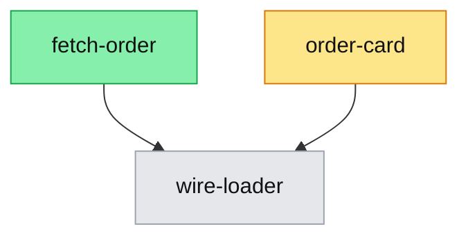

# Build Feature

Run the full feature path. This skill is the driver. It loads other pack skills. It does not invent a third planning method.

Leaves stay callable alone. This is the only pack skill that names them for a pipeline, besides `fix-bug` offering `prove-it`.

## When To Use

Load when the user runs `/build-feature`, or asks to implement / build a feature (including a refactor that is not a failure).

Skip if a failure is already in play. That job is `fix-bug`. Skip typos, comments, format, docs-only. Skip if they only asked for one leaf (`/touch-map`, `/lego-plan`, and similar).

## Hard Gates

1. **No production code before the spec and the DAG exist.** Write plan 1 and plan 2 first.
2. **No approval stops after the grill.** `grill-me` is the last place where the driver waits for the user. Write plan 1 and plan 2, show their paths, and continue in the same turn. Do not ask "approve?". The user interrupts if a plan is wrong.
3. **`grill-me` is the only interview.** Do not run Superpowers `brainstorming` questions.
4. **Do not commit** the spec file or the plan file.
5. **Start each node as soon as it is ready.** A node is ready when all its `depends` are `done`. Do not wait for the rest of its layer. Do not wait for in-progress nodes that it does not depend on. Example: `b2` is still running, and `c1` depends only on `a1` and `b1`, which are `done`. Start `c1` now. Do not use Superpowers `subagent-driven-development` as the dispatcher (that loop is one task, then review, then the next).
6. **Every implementer subagent must be told to load** `typescript-standards`, `test-hygiene`, `reuse-first`, and `docs`. Pass the reader list and tone that the driver chose (with any change from the user). Workers do not re-ask persona or tone. Workers do not get `grill-me`, `touch-map`, `lego-plan`, `writing-plans`, or `prove-it`.
7. **Do not load `prove-it` until the end ask.** Default skip. A green DAG is not proof.
8. **The driver paints. Subagents never paint.** After every live-board status change, the next user-visible message MUST contain a full Mermaid of the board. `done` nodes are green (`:::done`). A JSON write, a prose recap, a todo list, or waiting until the layer (or the whole run) ends does not count. If several subagents return in one wake, paint once with every new status. Do not skip the fence because more than one finished.
9. **The paint wins over brevity rules.** `AGENTS.md`, `CLAUDE.md`, a skill, or the user can say "be concise" or "keep replies short". The paint still goes in every message that has a node change. Make the prose shorter. Never drop the fence or shorten it. Only a direct user request in this conversation to stop the paint can turn it off.
10. **The driver picks readers and tone. It does not stop for them.** The driver shows its choice in the chat, then continues. The user can change the choice at any time. This overrides the `docs` persona gate and tone gate default (stop).

## Flow

```text
grill-me (or skip if design is already settled)
  → docs Phase 1: pick readers, show them, continue (no stop)
  → write spec, show the path, continue
  → touch-map
  → reuse-first (once, on files-to-touch)
  → lego-plan
  → writing-plans file from the DAG, show the path, continue
  → pick tone if any node writes docs pages, show it, continue (no stop)
  → implement: start each node when its depends are done; driver paints DAG after each change
  → optional prove-it
```

Load each named skill and follow it. Overrides in this file win where they conflict (`writing-plans` grain, no sequential dispatcher, do not commit those two files, driver paints the live DAG, `docs` gates do not stop). `lego-plan` forbids `classDef` on the **plan** emit. This driver paint is the exception.

## Paint the live DAG

The user-facing product during implement is the **colored Mermaid**, not the JSON.

The **driver** (this conversation, the main agent) paints. A worker subagent must not emit the live DAG. Ignore a worker mermaid if one appears.

Paint after:

1. Setting one or more ready nodes to `in-progress`, **before** spawn.
2. **Each** subagent return (this conversation wakes). First actions: update JSON from `done when`, then paint in the user-visible reply, then continue.
3. Marking a node red.

The paint is a fenced `mermaid` block in chat. Tool logs and subagent transcripts are not the paint.

Always paint. A brevity rule from `AGENTS.md`, `CLAUDE.md`, another skill, or a "be concise" style does not remove the paint (Hard gate 9). Cut the prose around it instead.

Form (ids match the live board; apply `:::pending` / `:::inprogress` / `:::done` / `:::failed` from JSON `status`):



Keep every node and the same edges. Do not drop finished nodes. `:::done` is green so the user can see what landed.

## Procedures

### Procedure 1: Route

1. If a test is red, CI is red, or the user says it is broken / fix this: stop. Tell them to use `fix-bug`. Do not start this flow.
2. Else Procedure 2.

### Procedure 2: Grill or skip

1. If this conversation already has a settled design (grill already done, or they pasted a spec): do not run `grill-me`. Write or copy it to the plan-1 path if that file is missing. Then Procedure 3.
2. Else load `grill-me` and follow it until the design is shared. Then Procedure 3.
3. If the spec file already exists **and** readers are already shown: Procedure 5.

### Procedure 3: Docs readers (no stop)

1. Load `docs`. Run Phase 1 only: who reads this, and which pages are new or changed.
2. Pick the readers yourself. Show the list in chat, in the `docs` format (name, story, pages).
3. Add one line under the list: the user can drop, add, or change a reader at any time.
4. Do not stop. Do not ask for permission. Do not end the turn. Go to Procedure 4 in the same turn.
5. If the user changes the readers later: update the spec and the worker prompts that did not start yet. If a node already wrote pages for an old reader list, fix those pages.

### Procedure 4: Write spec (plan 1), no stop

1. Path: `docs/superpowers/specs/YYYY-MM-DD-<topic>-design.md` (today’s date, kebab topic). New file. Create parent dirs if needed.
2. Write a short **design spec**: what we build, choices from the grill, the chosen readers, doc-impact pages. Not a task list. Not full source.
3. Open the file. Do not `git add` it. Do not commit it.
4. Show both paths of the spec (relative and absolute) in chat. Do not ask for approval. Do not end the turn.
5. If the user asks for changes later: edit the spec, and pass the change to the nodes that did not start yet.
6. Procedure 5.

### Procedure 5: Map, reuse, lego

1. Load `touch-map` and follow it (six-section map, then it stops).
2. Load `reuse-first` once on the files-to-touch list. Record the `reuse:` line. The DAG must not invent a helper that this pass found.
3. Load `lego-plan` and follow it (chat DAG + `.agent/scratch/lego-plan.json`).
4. Procedure 6.

### Procedure 6: Implementation plan (plan 2), no stop

1. Announce that `writing-plans` is in use, with **node grain** (not 2-minute steps).
2. Load Superpowers `writing-plans` for header and file path only.
3. Path: `docs/superpowers/plans/YYYY-MM-DD-<topic>.md`. New file.
4. Tasks are the lego **nodes**. Each task has id, name, depends, files, parts, done-when. Embed the Mermaid DAG (same ids). Point at `.agent/scratch/lego-plan.json`. **No full production source.** Do not ask which execution mode. This skill is the driver.
5. Open the file. Do not commit it.
6. Show both paths of the plan in chat. Do not ask for approval. Do not end the turn.
7. If the user asks for changes later: edit the plan and the live board together (keep ids stable).
8. Procedure 7.

### Procedure 7: Tone, then implement

1. If any node `files` include docs pages, and tone is not already chosen in this conversation: infer the tone from neighbor pages (as `docs` does). Show it in one line in chat, and say that the user can change it at any time. Do not stop. Continue.
2. If no docs pages: skip tone.
3. Ready nodes = every `pending` node whose `depends` are all `done` (empty depends = ready). Layer numbers do not matter here. Only `depends` matters.
4. Set those nodes to `in-progress` in `.agent/scratch/lego-plan.json`. **Paint the live DAG** (see above). Then spawn.
5. Spawn **one subagent per new in-progress node**, in parallel, without waiting for nodes that are already running. Each prompt must include:
   - node id, name, files, ordered parts, done-when
   - the spec path and the relevant spec facts
   - the chosen readers and tone (if that node writes docs)
   - **Load these skills and follow them:** `typescript-standards`, `test-hygiene`, `reuse-first`, `docs`
   - do not edit paths outside `files`
   - do not re-plan, do not grill, do not re-ask persona or tone
   - do not paint the live DAG (the driver paints)
6. When a subagent returns, the **main agent** does this **before** any other user-facing text: run that node’s `done when`; set `done` or red; update the JSON; **Paint the live DAG**. Then go to step 3 at once: start every node that this return made ready, while other nodes still run. Do not hold the paint or the spawn until the layer or the run ends.
7. If `done when` is red or the subagent errors: keep other in-progress nodes running. Paint with `:::failed` on that node. Load `fix-bug` for that node (driver or a subagent with the same file list). Nodes that depend on the red node (directly or through other nodes) wait until it is `done`, or the user stops the run. Nodes that do not depend on it keep starting.
8. If the user changes readers or tone while nodes run: pass the change to nodes that did not start yet. After the running docs nodes return, fix their pages to match.
9. Repeat from step 3 until every node is `done`.
10. Procedure 8.

### Procedure 8: Optional prove-it

1. Do not ask. Default **skip**.
2. If the user asked to prove in this conversation: load `prove-it` and follow it. Then Procedure 9.
3. Else say that the feature is **not proved** as a user path, and that the user can ask for `prove-it`. Procedure 9.

### Procedure 9: Stop

Stop. Do not start unrelated work.

## Decision Tree

- Failure already in play → Procedure 1 (stop, `fix-bug`).
- `/build-feature` or implement a feature → Procedure 2 → … → 9.
- Design already settled → skip `grill-me` (Procedure 2 step 1).
- Readers or tone not chosen yet → pick them, show them, continue (no stop).
- User changes readers or tone → apply it; do not restart the flow.
- No docs pages in the DAG → skip tone.
- 2+ ready nodes → parallel (Hard gate 5).
- A node is ready while an unrelated node still runs → start it now (Hard gate 5).
- Subagent returned → Procedure 7 step 6 (paint first, then start new ready nodes).
- Brevity rule in `AGENTS.md` / `CLAUDE.md` → still paint (Hard gate 9).
- Node red → `fix-bug`; its dependents wait; all other nodes continue. Paint `:::failed`.
- All nodes `done` → Procedure 8.

## Red Flags

| Signal                                           | What it means                        | Do instead                                      |
| ------------------------------------------------ | ------------------------------------ | ----------------------------------------------- |
| Coding during grill or before plan 2 exists      | Skipped the plans                    | Hard gate 1.                                    |
| Superpowers `brainstorming` questions            | Second interview                     | `grill-me` only.                                |
| Committing the spec or plan file                 | Generated artifact in git            | Hard gate 4.                                    |
| One node, then review, then the next             | Sequential dispatcher                | Hard gate 5. Parallel ready nodes.              |
| Classic `writing-plans` full source in steps     | Wrong grain                          | Procedure 6. Nodes, no source dump.             |
| Worker without `docs` / `typescript-standards`   | Quality gate dropped                 | Hard gate 6. Put the four skills in the prompt. |
| Worker asks personas again                       | Double docs gate                     | Pass the chosen list.                           |
| Turn ends on "confirm these readers?"            | Stopped for permission               | Hard gate 10. Show the list, then continue.     |
| Turn ends on "which tone?"                       | Stopped for permission               | Hard gate 10. Show the tone, then continue.     |
| Loading `prove-it` before the end                | Unasked proof                        | Procedure 8.                                    |
| Ready node waits for an unrelated running node   | Slow DAG                             | Hard gate 5. Start it now.                      |
| "Wait for the layer to finish"                   | Layer barrier                        | Only `depends` blocks a node.                   |
| A node starts before its `depends` are `done`    | Broke the DAG                        | Procedure 7 step 3.                             |
| No fence because `AGENTS.md` says be concise     | Brevity rule beat the paint          | Hard gate 9. Paint. Cut the prose.              |
| Skipping `reuse-first` before `lego-plan`        | DAG invents existing helpers         | Procedure 5 step 2.                             |
| Running this on “fix this failing test”          | Wrong skill                          | Procedure 1.                                    |
| Subagent returned and chat has no new Mermaid    | Hard gate 8 missed                   | Paint now. Then continue.                       |
| Prose “node X is done” with no fence             | Recap is not the board               | Paint the live DAG.                             |
| One paint after the whole layer or the whole run | User cannot see progress             | Paint after each return.                        |
| Unstyled mermaid during implement                | Plan emit leaked into the live board | `:::done` is green.                             |
| Worker mermaid treated as the paint              | Wrong painter                        | Driver paints. Ignore the worker fence.         |

## Error Handling

- **`grill-me` missing:** interview in the same shape (one question at a time, recommended option first). Say the skill file was not found.
- **`writing-plans` missing:** still write plan 2 at the Superpowers plan path with the node contract. Say the skill file was not found.
- **`docs` missing:** stop. Do not skip docs. Tell the user.
- **Cannot spawn parallel subagents:** run the ready nodes one at a time. Say that in chat. Keep the same prompts and skills.
- **User rejects spec or plan:** stop dispatch of new nodes. Edit the file and the live board. Then continue.
- **User stops the run while nodes run:** stop dispatch. Leave the live board as it is. Do not mark skipped nodes `done`.
- **`prove-it` missing:** say so. Do not invent a second prove procedure.
- **They pick `prove-it`, then skip inside it:** not proved. Procedure 9.
- **Paint omitted from a completion message:** emit the painted DAG immediately. Do not start new nodes until that fence is in chat.
- **Harness wakes once for several finished workers:** update every returned node, then paint once. Do not skip because the wake was a batch.
